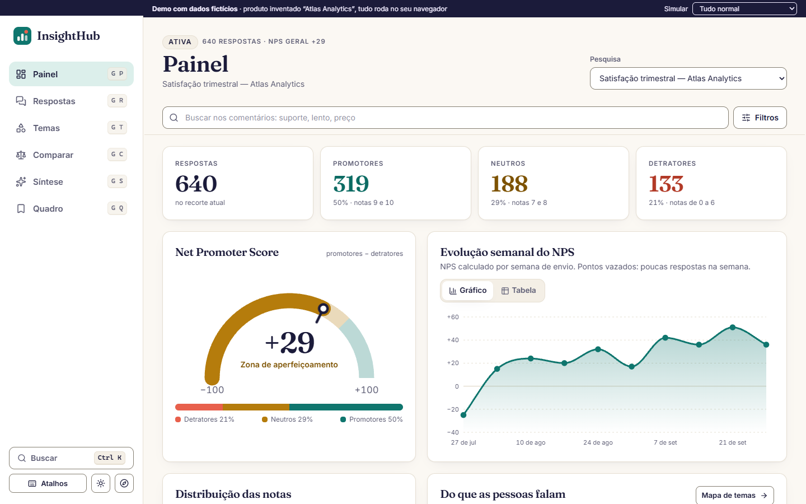
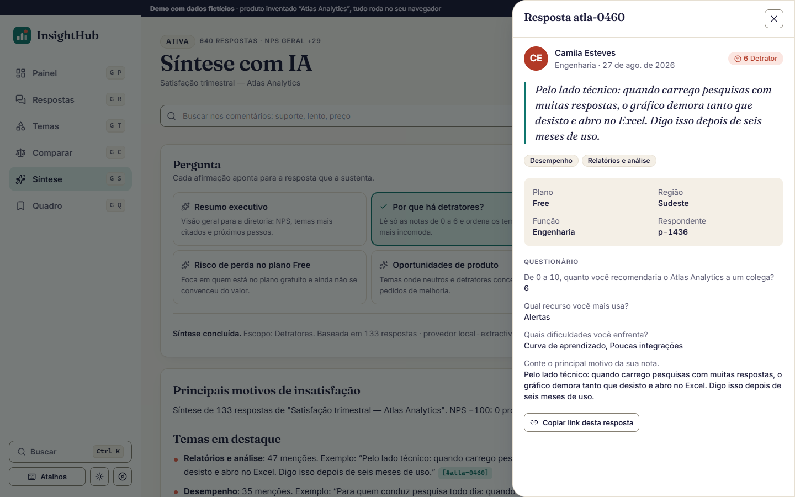
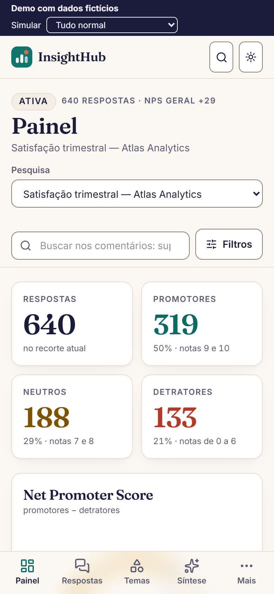
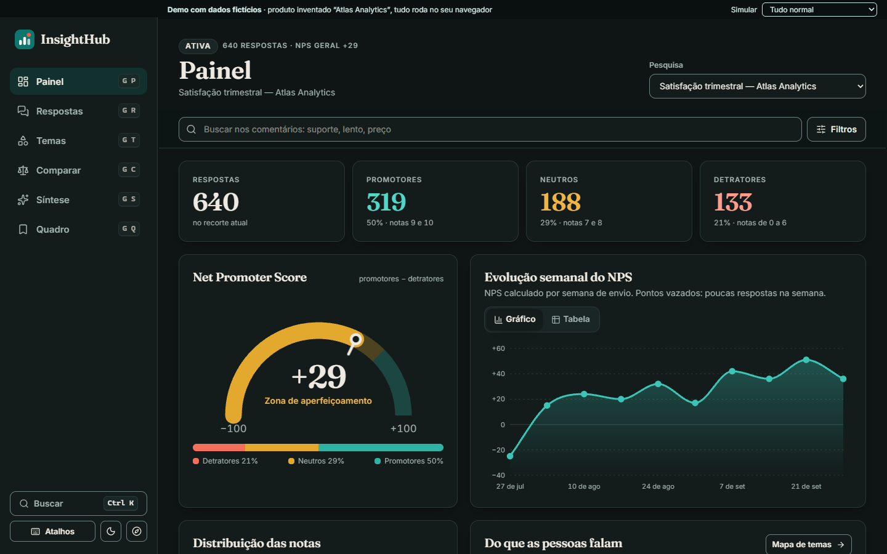
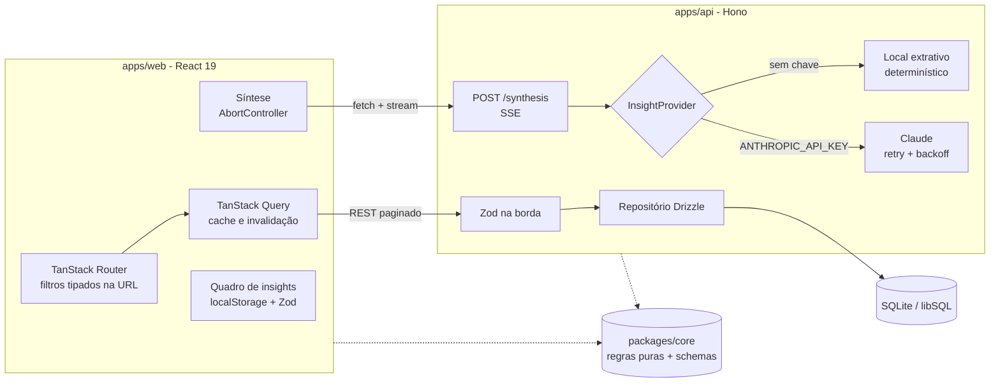

# InsightHub · da pesquisa à decisão

[](https://github.com/NasckDev/insighthub/actions/workflows/ci.yml)


Workspace editorial para times de pesquisa e produto: ler o NPS, ouvir o que as pessoas dizem, comparar segmentos, pedir uma síntese **com fontes clicáveis** e guardar o que virou decisão. Toda afirmação da síntese aponta para o id da resposta que a sustenta.

> Todos os dados são **100% fictícios** (seed determinístico com o produto inventado "Atlas Analytics").

## Demo no navegador

A interface roda **100% no navegador**, sem servidor: o mesmo `core` (NPS, filtros, temas, comparação, síntese extrativa) processa o seed fictício localmente, com latência simulada. Demo publicada: <https://nasckdev.github.io/insighthub/>.

| Painel: NPS em medidor, evolução, temas e falas | Comparar segmentos com aviso de amostra pequena |
| --- | --- |
|  |  |

| Síntese com a citação aberta ao lado | Celular (390 px) |
| --- | --- |
|  |   |

| Mapa de temas com drill-down | Tema escuro | Quadro de insights |
| --- | --- | --- |
|  |  |  |

Outros prints em [`docs/prints/`](docs/prints): respostas com facetas (`respostas-desktop.png`), temas no escuro (`temas-escuro-desktop.png`) e as telas de celular (`temas-celular.png`, `quadro-celular.png`, `visao-geral-escuro-celular.png`).

## O que existe em cada tela

- **Painel**: medidor de NPS com as quatro zonas de leitura, evolução semanal em área suave, distribuição das notas, temas principais com sentimento e **falas em destaque**. Filtros de período, plano, região, função, tema e busca vivem na URL (`#/s/s-atlas-q3/visao-geral?plan=pro&theme=suporte&from=2026-08-10`) e são validados pelos schemas Zod do `core`.
- **Respostas**: tabela com **facetas e contagens ao vivo**, busca com o termo destacado, ordenação, paginação, tags de tema e sentimento, e **painel lateral de detalhe** (folha inferior no celular). No celular a tabela vira lista de cartões.
- **Temas**: **treemap** em que a área é o volume e a cor/ícone é o sentimento. Clicar abre o drill-down com as falas, e dali você vai para a tabela filtrada ou pede a síntese só daquele tema.
- **Comparar**: segmentos por plano, região ou função em **barras divergentes** contra o NPS geral, cartões lado a lado, destaque da maior diferença e **aviso de amostra pequena** (menos de 10 respostas): o segmento aparece listrado e com selo, nunca escondido.
- **Síntese com IA**: cinco **modelos de pergunta** (resumo executivo, por que há detratores, o que os promotores valorizam, risco no plano Free, oportunidades), streaming com **cancelar** e **tentar de novo**, citações `[#id]` clicáveis que abrem a resposta e **salvar no quadro**.
- **Quadro de insights**: cards com título e nota editáveis, exclusão com **desfazer**, exportação em **Markdown e CSV** e **link compartilhável** que outra pessoa pode importar.
- **Em todo lugar**: paleta de comandos (`Ctrl/⌘ K`) com busca real nos comentários, atalhos documentados no modal `?` (`G` e uma letra para ir a cada tela, `/` para buscar, `T` para o tema), tour opcional de 3 passos, tema claro/escuro com a escolha lembrada, toasts, esqueletos com brilho e ilustrações próprias nos estados vazios e de erro.
- **Estados**: carregando, vazio, erro com "Tentar de novo" e resultado parcial em todas as telas. O seletor **Simular** na faixa da demo força "falhar a próxima chamada" e "respostas parciais".

## Identidade

Fraunces nos títulos, nos números de destaque e nas falas dos clientes; Inter na interface. Papel `#FBF8F3`, tinta `#1B1B3A`, petróleo `#0F766E`, coral `#E8604C`, âmbar e ameixa de apoio; escuro com fundo `#0E1514`. Cantos de 10 a 14 px, linhas finas e sombras leves. As decisões estão no [ADR 0003](docs/adr/0003-identidade-editorial-e-graficos-proprios.md).

## Acessibilidade

Meta WCAG 2.2 AA, verificada com ferramenta e não por impressão:

- **Contraste calculado nos dois temas**: `apps/web/src/lib/contrast.test.ts` lê os tokens de `styles.css` e confere 29 pares (4,5:1 para texto, 3:1 para gráficos e controles). Ele provou que o âmbar da marca falhava (2,4:1) e o gráfico passou a usar um tom mais escuro.
- **axe-core sem violações** em todas as telas, nos dois temas, em 390, 768 e 1440 px, e no painel de detalhe e na paleta de comandos (E2E com `@axe-core/playwright`).
- Teclado completo: link "Pular para o conteúdo", foco visível, modais com foco preso, `Esc` fecha e devolve o foco a quem abriu; gráficos focáveis que se percorrem com as setas.
- Cor nunca é o único sinal (ícone e palavra em faixas e sentimentos), alvos de 44 px em dispositivos de toque, `safe-area-inset` respeitado, sem rolagem horizontal de 320 a 1440 px.
- Todo gráfico tem descrição para leitor de tela e **alternativa em tabela**. Animações desligam com `prefers-reduced-motion`.

### Camada de dados

A UI só conhece a interface `DataClient` (`apps/web/src/data/types.ts`), com dois adaptadores:

- `demo` (padrão): roda o `core` no navegador sobre o seed, com latência e falhas simuláveis.
- `http`: fala com a `apps/api` quando `VITE_API_URL` existe. Como a API não tem endpoints de agregação, painel, temas e facetas são calculados a partir das respostas paginadas. A ordenação da tabela só existe no adaptador `demo`.

```bash
npm run dev:mock -w @insighthub/web      # demo, mesmo que exista VITE_API_URL
npm run dev -w @insighthub/web           # demo; com VITE_API_URL em apps/web/.env.local usa a API
```

### Build portátil (qualquer subpath)

O build usa `base: './'` e roteamento por **hash** (`#/...`), então funciona em qualquer subpath e recarrega em qualquer rota sem regra de rewrite no servidor:

```bash
npm run build:portable      # gera apps/web/dist e falha se o index.html tiver URL absoluta
```

Copie `apps/web/dist` para onde quiser (ex.: `<site>/projetos/insighthub/`) e sirva como arquivos estáticos. O workflow [`pages.yml`](.github/workflows/pages.yml) publica essa mesma pasta no GitHub Pages a cada push em `main` que toque o web ou o core.

## Desempenho

Rotas carregadas sob demanda: cada tela é um chunk próprio. Tamanho do build portátil de `apps/web/dist` (gzip, medido no `vite build`):

| Parte | gzip |
| --- | --- |
| JavaScript inicial (React, roteador, query, motion e casca do app) | ≈ 199 kB (`index` 96,1 + vendor 92,9 + estados 9,9) |
| CSS | 8,2 kB |
| Tela do Painel (sob demanda) | 6,4 kB |
| Síntese / Comparar / Quadro / Temas / Respostas (sob demanda) | 4,3 / 3,0 / 2,9 / 2,4 / 2,0 kB |
| Fontes WOFF2 (latim, sem CDN) | Fraunces 36,6 kB, Fraunces itálico 45,7 kB, Inter 48,3 kB |

`apps/web/dist` inteiro: 882 kB em disco, 22 arquivos.

## Arquitetura



`packages/core` concentra as regras puras e os **schemas Zod compartilhados**: o mesmo schema de filtros valida a query string na API e os search params da URL na web. Também vivem ali a análise de temas e sentimento, as facetas, as falas em destaque, os modelos de pergunta da síntese, o treemap (`squarify`) e o domínio do quadro de insights (exportação Markdown/CSV e link compartilhável).

## Rodando localmente

Pré-requisito: Node 22+.

```bash
npm install
cp .env.example .env            # opcional
npm run db:setup -w @insighthub/api   # cria o SQLite e aplica o seed fictício
npm run start -w @insighthub/api      # http://localhost:3333
npm run dev:mock                      # só a interface, com dados no navegador
```

### Variáveis de ambiente

Veja [.env.example](.env.example). Nenhum segredo fica no código: `ANTHROPIC_API_KEY` é lida do ambiente e é **opcional** — sem ela a API usa o provider local determinístico.

| Variável | Padrão | Descrição |
| --- | --- | --- |
| `PORT` | `3333` | Porta da API |
| `DATABASE_URL` | `file:./insighthub.db` | URL libSQL (arquivo local por padrão) |
| `CORS_ORIGINS` | `http://localhost:5173` | Origens permitidas (lista separada por vírgula) |
| `RATE_LIMIT_PER_MINUTE` | `120` | Limite geral por cliente |
| `SYNTHESIS_LIMIT_PER_MINUTE` | `10` | Limite do endpoint de síntese |
| `ANTHROPIC_API_KEY` | — | Ativa o provider Claude |
| `ANTHROPIC_MODEL` | `claude-opus-5-5` | Modelo usado pelo provider Claude |
| `INSIGHTHUB_API_TOKEN` | — | Token Bearer (mín. 16 caracteres) exigido no `POST /synthesis`. **Obrigatório** com `ANTHROPIC_API_KEY`: a API se recusa a subir sem ele |
| `VITE_API_URL` | — | Só no web (`apps/web/.env.local`). Vazio: demo no navegador |

## API

Todas as respostas JSON usam o envelope `{ success, data, error, meta }`.

| Método | Rota | Descrição |
| --- | --- | --- |
| GET | `/api/health` | Status e provider ativo |
| GET | `/api/surveys` | Pesquisas com total de respostas e NPS |
| GET | `/api/surveys/:id` | Pesquisa com perguntas (NPS, escolha única, múltipla, aberta) |
| GET | `/api/surveys/:id/responses` | Respostas paginadas. Filtros: `plan`, `region`, `role` (listas por vírgula), `nps`, `theme`, `from`, `to` (`AAAA-MM-DD`), `q`, `page`, `pageSize` (≤ 100) |
| GET | `/api/surveys/:id/responses/:responseId` | Resposta-fonte (destino das citações) |
| GET | `/api/surveys/:id/compare?dimension=plan\|region\|role` | NPS e distribuição por segmento, com flag de amostra pequena |
| POST | `/api/surveys/:id/synthesis` | Síntese em **SSE** (`meta`, `delta`, `citation`, `done`, `error`). Corpo: `{ "filters": {...}, "focus": "overview\|problems\|strengths\|opportunities" }`. Com `INSIGHTHUB_API_TOKEN` definido exige `Authorization: Bearer <token>` (401 sem ele) |

Exemplo:

```bash
curl "http://localhost:3333/api/surveys/s-atlas-q3/compare?dimension=plan&region=sul,sudeste"
curl -N -X POST http://localhost:3333/api/surveys/s-atlas-q3/synthesis \
  -H "content-type: application/json" -d '{"filters":{"plan":["free"]},"focus":"problems"}'
```

## Decisões

- **Filtros persistidos na URL** para visões compartilháveis — o schema de filtros vive no `core` e é reutilizado na borda da API. ([ADR 0002](docs/adr/0002-filtros-na-url-e-schemas-compartilhados.md))
- **`InsightProvider`** como contrato da síntese: provider local extrativo (temas, sentimento e citação representativa com id da resposta) e provider Claude opcional. ([ADR 0001](docs/adr/0001-insight-provider-com-fallback-local.md))
- **Identidade editorial, contraste provado em teste e gráficos em SVG próprio.** ([ADR 0003](docs/adr/0003-identidade-editorial-e-graficos-proprios.md))
- **Quadro de insights local, exportação segura e link compartilhável sem servidor.** ([ADR 0004](docs/adr/0004-quadro-de-insights-local-e-link-compartilhavel.md))
- **Rastreabilidade**: citações `[#id]` geradas pelo modelo são validadas contra o conjunto de fontes enviado; ids inexistentes são descartados e a citação usa o texto real da resposta, nunca o texto do modelo. Na interface, só id confirmado por um evento `citation` vira botão.
- **Cancelamento e retry**: o cancelamento do cliente aborta o stream (AbortController ponta a ponta); o retry com backoff exponencial só reexecuta erros transitórios (429, 5xx, conexão) e respeita o abort.
- **Segurança**: o `POST /synthesis` exige token Bearer (comparação em tempo constante, checada antes do rate limit) e a API **não sobe** com `ANTHROPIC_API_KEY` sem `INSIGHTHUB_API_TOKEN`, para que ninguém dispare chamadas pagas. O token é segredo de servidor: o front estático **não** o embute (variáveis `VITE_*` vão para o bundle público), então a demo publicada usa o provider local. Além disso: validação Zod em toda entrada (inclusive o link compartilhado do quadro), ids com regex restrita, busca parametrizada com `instr()`, CORS por lista de origens, `secureHeaders`, limite de corpo de 16 KB, rate limit por IP, comentários tratados como dados no prompt, texto de síntese renderizado como React (nunca HTML) e CSV com neutralização de fórmulas.

## Testes

Números reais da última rodada (Vitest 5 e Playwright 1.65):

| Camada | Arquivos | Testes | O que cobre |
| --- | --- | --- | --- |
| `packages/core` (unitários) | 7 | 53 | NPS, filtros (inclusive tema e período), facetas, temas e sentimento, falas em destaque, comparação com diferenças, retry/abort, síntese e modelos de pergunta, citações, treemap, domínio do quadro (Markdown, CSV seguro, link), seed |
| `apps/api` (integração) | 1 | 16 | Envelope, paginação, filtros, 400/404, SSE, CORS, 429, token Bearer |
| `apps/web` unitários | 8 | 83 | 59 pares de contraste nos dois temas, curva monotônica, zonas do NPS, formatação pt-BR, descrição de filtros, parâmetros da URL, store do quadro, pessoas fictícias |
| `apps/web` componente (app inteiro sobre a história em memória) | 3 | 32 | Filtros e paginação na URL, estados de carregando/vazio/erro/parcial, tabela alternativa, aviso de amostra pequena, mapa de temas com drill-down, facetas, modelos de pergunta, síntese com citação, cancelar e stream interrompido, quadro (salvar, editar, excluir e desfazer, importar link), paleta de comandos e atalhos |
| `apps/web` E2E (Playwright + axe) | 1 | 19 | axe sem violações nas 6 telas × 2 temas, painel, filtrar, abrir resposta com foco devolvido, gerar síntese e salvar no quadro, recarregar numa rota interna sem erro de console nem 404, paleta, celular a 360 px sem rolagem horizontal |

Total: **184 testes em Vitest** (53 + 16 + 83 + 32) e **19 E2E**, todos passando. Lint, typecheck e build portátil limpos.

```bash
npm run lint && npm run typecheck && npm test && npm run build:portable
npm run e2e        # Playwright + axe contra o build portátil servido em /projetos/insighthub/
```

## Roadmap

- [x] Filtros na URL, comparação, síntese em streaming com cancelar e citações clicáveis, gráficos com tabela alternativa.
- [x] Deploy do front com dados mock no GitHub Pages.
- [x] Identidade editorial, temas com treemap, quadro de insights, paleta de comandos, atalhos e tour.
- [x] Playwright + `@axe-core/playwright` nos fluxos principais.
- [ ] Endpoints de agregação na API (hoje painel, temas e facetas do adaptador `http` agregam no cliente).
- [ ] Persistir o quadro no servidor e compartilhar por id curto.
- [ ] Ordenação da tabela de respostas na API.
- [ ] OpenAPI.

## Licença

[MIT](LICENSE) © Alexandre Diogo Nascimento
