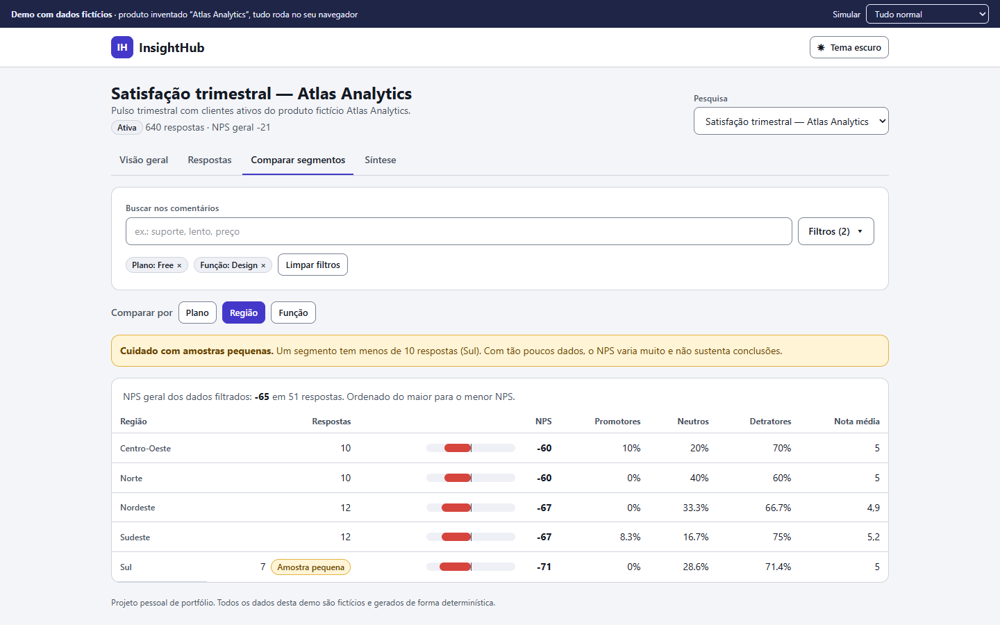
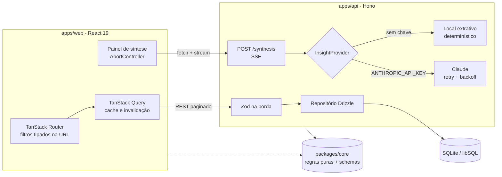

# InsightHub · Research & AI Insights Workspace

[](https://github.com/NasckDev/insighthub/actions/workflows/ci.yml)


Workspace para explorar pesquisas, comparar segmentos e gerar sínteses assistidas por IA **com rastreabilidade**: toda afirmação da síntese aponta para o id da resposta que a sustenta.

> Todos os dados são **100% fictícios** (seed determinístico com produto inventado "Atlas Analytics").

## Demo no navegador

A interface roda **100% no navegador**, sem servidor: o mesmo `core` (NPS, filtros, comparação, síntese extrativa) processa o seed fictício localmente, com latência simulada. Demo publicada: <https://nasckdev.github.io/insighthub/>.

| Visão geral: NPS, distribuição e evolução | Comparar segmentos com aviso de amostra pequena |
| --- | --- |
|  |  |

| Síntese com citação aberta | Celular (390 px) |
| --- | --- |
|  |   |

O que existe nas telas:

- **Visão geral**: NPS, distribuição das notas e evolução semanal. Cada gráfico tem uma alternativa em tabela com os mesmos dados.
- **Respostas**: tabela paginada; filtros, busca e página ficam na URL (`#/s/s-atlas-q3/respostas?plan=pro,free&nps=detractor&page=2`) e são validados pelos schemas Zod do `core`. Valores inválidos na URL são descartados, não quebram a tela.
- **Comparar segmentos**: por plano, região ou função, com aviso quando um segmento tem menos de 10 respostas.
- **Síntese**: streaming simulado, botão **Cancelar** e citações `[#id]` clicáveis que abrem a resposta-fonte. Só ids confirmados pelo evento `citation` viram botão; o resto fica como texto.
- **Estados**: carregando, vazio, erro com "Tentar de novo" e resultado parcial em todas as telas. O seletor **Simular** na faixa da demo força "falhar a próxima chamada" e "respostas parciais" para ver esses estados.
- **Acessibilidade e UX**: tema claro/escuro, mobile-first (testado em 390 px), link "Pular para o conteúdo", foco visível, navegação por teclado, modal com foco preso e `Esc`, contraste AA e `prefers-reduced-motion`.

### Camada de dados

A UI só conhece a interface `DataClient` (`apps/web/src/data/types.ts`), com dois adaptadores:

- `demo` (padrão): roda o `core` no navegador sobre o seed, com latência e falhas simuláveis.
- `http`: fala com a `apps/api` quando `VITE_API_URL` existe. Como a API não tem endpoints de agregação, a visão geral é calculada a partir das respostas paginadas.

```bash
npm run dev:mock -w @insighthub/web      # demo, mesmo que exista VITE_API_URL
npm run dev -w @insighthub/web           # demo; com VITE_API_URL em apps/web/.env.local usa a API
```

### Build portátil (qualquer subpath)

O build usa `base: './'` e roteamento por **hash** (`#/...`), então funciona em qualquer subpath e recarrega em qualquer rota sem regra de rewrite no servidor:

```bash
npm run build:portable      # gera apps/web/dist e falha se o index.html tiver URL absoluta
```

Copie `apps/web/dist` para onde quiser (ex.: `<site>/projetos/insighthub/`) e sirva como arquivos estáticos. O workflow [`pages.yml`](.github/workflows/pages.yml) publica essa mesma pasta no GitHub Pages a cada push em `main` que toque o web ou o core.

## Problema

Times de pesquisa e produto precisam transformar respostas, segmentos e indicadores em insights acionáveis. A experiência costuma ser fragmentada entre filtros complexos, tabelas, gráficos, comentários e geração de sínteses — e sínteses de IA sem fonte não são confiáveis.

## Status

| Parte | Estado |
| --- | --- |
| `packages/core` — regras de domínio (NPS, filtros, comparação, retry, síntese extrativa, seed) | ✅ pronto, testado |
| `apps/api` — Hono + Zod + Drizzle/libSQL, SSE com cancelamento, rate limit, CORS restrito | ✅ pronto, testado |
| `apps/web` — React 19 + TanStack Router/Query + Tailwind 4 | ✅ pronto: demo estática no navegador, testada ([ver abaixo](#demo-no-navegador)) |

## Arquitetura



`packages/core` concentra as regras puras e os **schemas Zod compartilhados**: o mesmo schema de filtros valida a query string na API e (na web) os search params da URL — uma única fonte de verdade.

## Rodando localmente

Pré-requisito: Node 22+.

```bash
npm install
cp .env.example .env            # opcional
npm run db:setup -w @insighthub/api   # cria o SQLite e aplica o seed fictício
npm run start -w @insighthub/api      # http://localhost:3333
```

Testes e typecheck:

```bash
npm test          # Vitest em todos os workspaces
npm run typecheck
```

### Variáveis de ambiente

Veja [.env.example](.env.example). Nenhum segredo fica no código: `ANTHROPIC_API_KEY` é lida do ambiente e é **opcional** — sem ela a API usa o provider local determinístico.

| Variável | Padrão | Descrição |
| --- | --- | --- |
| `PORT` | `3333` | Porta da API |
| `DATABASE_URL` | `file:./insighthub.db` | URL libSQL (arquivo local por padrão) |
| `CORS_ORIGINS` | `http://localhost:5173` | Origens permitidas (lista separada por vírgula) |
| `RATE_LIMIT_PER_MINUTE` | `120` | Limite geral por cliente |
| `SYNTHESIS_LIMIT_PER_MINUTE` | `10` | Limite do endpoint de síntese |
| `ANTHROPIC_API_KEY` | — | Ativa o provider Claude |
| `ANTHROPIC_MODEL` | `claude-opus-5-5` | Modelo usado pelo provider Claude |
| `INSIGHTHUB_API_TOKEN` | — | Token Bearer (mín. 16 caracteres) exigido no `POST /synthesis`. **Obrigatório** com `ANTHROPIC_API_KEY`: a API se recusa a subir sem ele |
| `VITE_API_URL` | — | Só no web (`apps/web/.env.local`). Vazio: demo no navegador |

## API

Todas as respostas JSON usam o envelope `{ success, data, error, meta }`.

| Método | Rota | Descrição |
| --- | --- | --- |
| GET | `/api/health` | Status e provider ativo |
| GET | `/api/surveys` | Pesquisas com total de respostas e NPS |
| GET | `/api/surveys/:id` | Pesquisa com perguntas (NPS, escolha única, múltipla, aberta) |
| GET | `/api/surveys/:id/responses` | Respostas paginadas. Filtros: `plan`, `region`, `role` (listas por vírgula), `nps`, `q`, `page`, `pageSize` (≤ 100) |
| GET | `/api/surveys/:id/responses/:responseId` | Resposta-fonte (destino das citações) |
| GET | `/api/surveys/:id/compare?dimension=plan\|region\|role` | NPS e distribuição por segmento, com flag de amostra pequena |
| POST | `/api/surveys/:id/synthesis` | Síntese em **SSE** (`meta`, `delta`, `citation`, `done`, `error`). Corpo: `{ "filters": {...} }`. Com `INSIGHTHUB_API_TOKEN` definido exige `Authorization: Bearer <token>` (401 sem ele) |

Exemplo:

```bash
curl "http://localhost:3333/api/surveys/s-atlas-q3/compare?dimension=plan&region=sul,sudeste"
curl -N -X POST http://localhost:3333/api/surveys/s-atlas-q3/synthesis \
  -H "content-type: application/json" -d '{"filters":{"plan":["free"]}}'
```

## Decisões

- **Filtros persistidos na URL** para visões compartilháveis — o schema de filtros vive no `core` e é reutilizado na borda da API. ([ADR 0002](docs/adr/0002-filtros-na-url-e-schemas-compartilhados.md))
- **`InsightProvider`** como contrato da síntese: provider local extrativo (frequências por tema + citação representativa com id da resposta) e provider Claude opcional. ([ADR 0001](docs/adr/0001-insight-provider-com-fallback-local.md))
- **Rastreabilidade**: citações `[#id]` geradas pelo modelo são validadas contra o conjunto de fontes enviado; ids inexistentes são descartados e a citação usa o texto real da resposta, nunca o texto do modelo.
- **Cancelamento e retry**: o cancelamento do cliente aborta o stream (AbortController ponta a ponta); o retry com backoff exponencial só reexecuta erros transitórios (429, 5xx, conexão) e respeita o abort.
- **Segurança**: o `POST /synthesis` exige token Bearer (comparação em tempo constante, checada antes do rate limit) e a API **não sobe** com `ANTHROPIC_API_KEY` sem `INSIGHTHUB_API_TOKEN`, para que ninguém dispare chamadas pagas. As rotas de leitura continuam abertas (dados fictícios). O token é segredo de servidor: o front estático **não** o embute (variáveis `VITE_*` vão para o bundle público), então a demo publicada usa o provider local. Além disso: validação Zod em toda entrada, ids com regex restrita, busca parametrizada com `instr()` (sem curingas de `LIKE`), CORS por lista de origens, `secureHeaders`, limite de corpo de 16 KB, rate limit por IP, comentários tratados como dados no prompt (mitigação de prompt injection).

## Testes

- `packages/core`: NPS, filtros/validação, comparação de segmentos, retry/backoff/abort, síntese extrativa e citações, seed determinístico.
- `apps/api`: integração com `app.request()` sobre SQLite em memória — envelope, paginação, filtros, 400/404, SSE, CORS, 429, token Bearer (401/200) e exigência do token com o provider Claude.
- `apps/web` (Vitest + Testing Library, app inteiro sobre história em memória): filtros e paginação na URL (inclusive valores inválidos), busca com debounce, estados de carregando/vazio/erro/parcial, aviso de amostra pequena, tabela alternativa dos gráficos, citações clicáveis que abrem a resposta-fonte, cancelamento do stream e stream interrompido.

```bash
npm run lint && npm run typecheck && npm test && npm run build:portable
```

## Roadmap

- [x] `apps/web`: filtros na URL (TanStack Router), comparação, síntese em streaming com cancelar e citações clicáveis, gráficos com tabela alternativa.
- [x] Deploy do front com dados mock no GitHub Pages.
- [ ] Playwright + `@axe-core/playwright` nos fluxos principais.
- [ ] Painel lateral redimensionável por teclado.
- [ ] Endpoints de agregação na API (hoje a visão geral do adaptador `http` agrega no cliente).
- [ ] OpenAPI.

## Licença

[MIT](LICENSE) © Alexandre Diogo Nascimento
