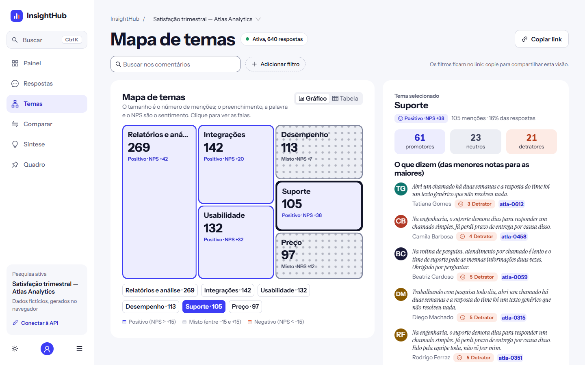
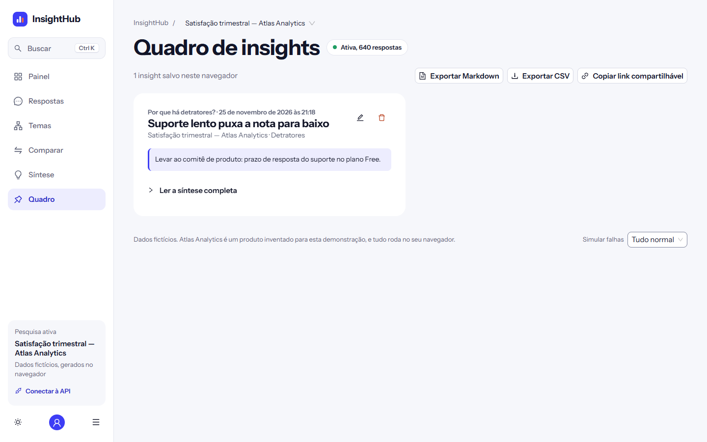
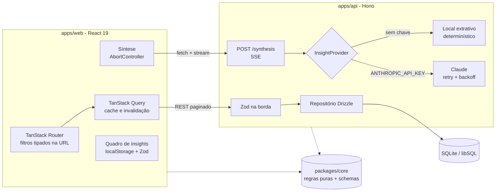

# InsightHub · da pesquisa à decisão

[](https://github.com/NasckDev/insighthub/actions/workflows/ci.yml)


Workspace editorial para times de pesquisa e produto: ler o NPS, ouvir o que as pessoas dizem, comparar segmentos, pedir uma síntese **com fontes clicáveis** e guardar o que virou decisão. Toda afirmação da síntese aponta para o id da resposta que a sustenta.

> Todos os dados são **100% fictícios** (seed determinístico com o produto inventado "Atlas Analytics").

## Demo no navegador

A interface é feita com **Ant Design e Apache ECharts**, atrás de uma camada própria (`apps/web/src/ui`) e documentada num **Storybook** (publicado em [/storybook/](https://nasckdev.github.io/insighthub/storybook/)). Ela roda **100% no navegador**, sem servidor: o mesmo `core` (NPS, filtros, temas, comparação, síntese extrativa) processa o seed fictício localmente, com latência simulada. Demo publicada: <https://nasckdev.github.io/insighthub/>.

| Painel: NPS em destaque, evolução, temas, síntese assistida e falas | Comparar segmentos com aviso de amostra pequena |
| --- | --- |
|  |  |

| Síntese com a citação aberta ao lado | Celular (390 px) |
| --- | --- |
|  |   |

| Mapa de temas com drill-down | Tema escuro | Quadro de insights |
| --- | --- | --- |
|  |  |  |

Outros prints em [`docs/prints/`](docs/prints): Filtros (`filtros-desktop.png`, `filtros-celular.png`), respostas com facetas (`respostas-desktop.png`, `respostas-celular.png`), temas no escuro (`temas-escuro-desktop.png`, `temas-escuro-celular.png`), comparação no celular (`comparar-amostra-pequena-celular.png`) e as demais telas de celular (`temas-celular.png`, `quadro-celular.png`, `visao-geral-escuro-celular.png`). Desktop em 1440×900 (DPR 1) e celular em 390×844 (DPR 2).

## O que existe em cada tela

- **Painel**: NPS em destaque (número grande em índigo, zona de leitura, promotores, neutros e detratores e a barra coral, névoa e índigo), evolução semanal com semanas de amostra pequena vazadas, temas mais citados com a barra de quem os cita, distribuição das notas, o painel **Síntese assistida** com perguntas prontas e **falas em destaque** em serifa itálica. Filtros de período, plano, região, função, tema e busca vivem na URL (`#/s/s-atlas-q3/visao-geral?plan=pro&theme=suporte&from=2026-08-10`) e são validados pelos schemas Zod do `core`.
- **Respostas**: tabela do Ant Design com **facetas e contagens ao vivo** (no celular, dentro do `Drawer` de Filtros), busca com o termo destacado, ordenação, paginação, tags de tema e sentimento, e **painel lateral de detalhe** (folha inferior no celular). No celular a tabela vira lista de cartões.
- **Temas**: **treemap do ECharts** em que a área é o volume e o preenchimento (liso, pontilhado, listrado) com a palavra é o sentimento. Clicar abre o drill-down com as falas, e dali você vai para a tabela filtrada ou pede a síntese só daquele tema.
- **Comparar**: abas de plano, região ou função e **barras divergentes** contra o NPS geral, cartões lado a lado, destaque da maior diferença e **aviso de amostra pequena** (menos de 10 respostas): o segmento aparece listrado e com selo, nunca escondido.
- **Síntese com IA**: cinco **modelos de pergunta** (resumo executivo, por que há detratores, o que os promotores valorizam, risco no plano Free, oportunidades), streaming com **cancelar** e **tentar de novo**, citações `[#id]` clicáveis que abrem a resposta e **salvar no quadro**.
- **Quadro de insights**: cards com título e nota editáveis, exclusão com **desfazer** (aviso com ação), exportação em **Markdown e CSV** e **link compartilhável** que outra pessoa pode importar.
- **Em todo lugar**: paleta de comandos (`Ctrl/⌘ K`) com busca real nos comentários, atalhos documentados no modal `?` (`G` e uma letra para ir a cada tela, `/` para buscar, `T` para o tema), tour opcional de 3 passos (um chip discreto no Painel, que nunca abre sozinho), tema claro/escuro com a escolha lembrada, toasts, esqueletos e ilustrações próprias nos estados vazios e de erro. Os filtros ativos viram pílulas removíveis e o botão **Copiar link** leva a visão com os filtros.
- **Estados**: carregando, vazio, erro com "Tentar de novo" e resultado parcial em todas as telas. O seletor **Simular falhas** no rodapé da demo força "falhar a próxima chamada" e "respostas parciais".

## Stack e licenças

- **React 19, Vite, TanStack Router e Query**, TypeScript estrito, Zod na borda.
- **Ant Design 6** para os componentes e **Apache ECharts 6** (`echarts/core` enxuto, renderizador SVG) para os gráficos, sempre através dos wrappers de `apps/web/src/ui`.
- **Tema central** (`ui/theme.ts`): a paleta do InsightHub vira tokens do `ConfigProvider` (`colorPrimary`, `colorBgLayout`, `fontFamily`, `borderRadius`, `controlHeight`, tokens de Layout, Menu, Table e Card), com `theme.darkAlgorithm` no escuro. Identidade "editorial de pesquisa": Instrument Sans em toda a interface e Instrument Serif itálico só nas falas dos respondentes (auto-hospedadas), índigo `#3D3DF5` para positivo e promotores, coral `#F2643D` para negativo só em gráficos e marcas (texto negativo em `#B8401E`), névoa `#D7D9E4` para neutros, tinta `#121528`, fundo `#F6F7FB`; no escuro, fundo `#0F1220`, superfície `#171B2E` e índigo `#9C9CFF`. Cartões de 20 px sem sombra, controles de 12 px, sem gradientes. As decisões estão no [ADR 0006](docs/adr/0006-ant-design-echarts-e-camada-de-ui.md).
- **Proteção do padrão**: uma regra `no-restricted-imports` barra `antd`, `echarts`, `echarts-for-react`, `@ant-design/icons` e `dayjs` fora de `src/ui`. Todas as versões do `package.json` são exatas.

| Dependência | Versão | Licença | Uso |
| --- | --- | --- | --- |
| antd | 6.7.1 | MIT | componentes |
| @ant-design/icons | 6.3.4 | MIT | ícones (só em `src/ui`) |
| echarts | 6.1.0 | Apache-2.0 | gráficos |
| echarts-for-react | 3.1.0 | MIT | integração React do ECharts |
| dayjs | 1.11.23 | MIT | datas do calendário (dependência do antd, só em `src/ui`) |
| react, react-dom | 19.3.1 | MIT | interface |
| @tanstack/react-router, @tanstack/react-query | exatas no `package.json` | MIT | rotas por hash e cache |
| zod | exata no `package.json` | MIT | validação |
| @fontsource-variable/instrument-sans, @fontsource/instrument-serif | 5.3.0 | OFL-1.1 | fontes auto-hospedadas |
| storybook, @storybook/react-vite, addon-a11y, addon-docs | 10.6.8 | MIT | documentação dos componentes (dev) |
| rollup-plugin-visualizer | 7.1.3 | MIT | análise do bundle (dev, só com `ANALYZE=1`) |
| vite, vitest, @playwright/test, @axe-core/playwright | exatas no `package.json` | MIT, MPL-2.0 (axe-core) | build e testes (dev) |

`npm audit --omit=dev` não aponta vulnerabilidades. O `npm audit` completo aponta 4 de severidade moderada, todas em `glob` e `minimatch` dentro do `@storybook/react-vite` (ferramenta de desenvolvimento, fora do bundle publicado).

### Camada de UI e Storybook

`apps/web/src/ui` tem os wrappers (nomes e props seguem o contrato do padrão: `variant`, `size`, `loading`, `disabled`, `icon` e `danger` no botão): `AppButton`, `AppIconButton`, `AppInput`, `AppSearchInput`, `AppTextArea`, `AppPasswordInput`, `AppSelect`, `AppCheckbox`, `AppSwitch`, `AppDatePicker`, `AppForm`/`AppFormItem`, `AppTable`, `AppList`, `AppCard`, `AppStatistic`, `AppTag`/`AppStatus`, `AppModal`, `AppDrawer`, `AppTabs`, `AppSteps`, `AppEmpty`, `AppSkeleton`, `AppAlert`/`AppResult`, `AppTooltip`, `AppDropdown`/`AppMenu`, `AppAvatar`, `AppPagination`, `AppSegmented`, `AppRadioCards`, `AppCollapse`, `useToast`, `AppLayout`/`AppSider`, `AppPageHeader`, `AppStack`/`AppGrid`/`AppTitle`/`AppText` e `AppChart`. Cada um tem `*.stories.tsx` ao lado, com estados (padrão, desabilitado, carregando, erro, vazio) e controles.

```bash
npm run storybook -w @insighthub/web        # http://localhost:6006
npm run build-storybook                     # apps/web/storybook-static (roda no CI)
```

## Identidade

Editorial e calma: papel quente, tinta escura, petróleo como cor de ação e coral como destaque, cantos de 12 a 14 px, linhas finas e quase nenhuma sombra. Layout corporativo do Ant Design (Sider recolhível, Header com busca e menu da conta, trilha de navegação, cartões com `Statistic`, tabelas, `Drawer`, `Modal`, `Result` e `Empty`) com a voz de revista de dados da Fraunces.

## Acessibilidade

Meta WCAG 2.2 AA, verificada com ferramenta e não por impressão:

- **Contraste calculado nos dois temas**: `apps/web/src/lib/contrast.test.ts` calcula os pares a partir da paleta de `ui/theme.ts` (4,5:1 para texto, 3:1 para gráficos e controles) e também confere os tokens que o Ant Design deriva sozinho, como o texto secundário e a borda de campo.
- **axe-core sem violações** nas 6 telas, nos dois temas, em **360 e 1440 px**, e em 390 px com toque (E2E com `@axe-core/playwright`); a **geometria dos diálogos** (Filtros, paleta, atalhos, Mais opções, Conectar à API e detalhe da resposta) é medida dentro da viewport em 1440, 768 e 390 px, porque o axe não vê um diálogo fora da tela.
- **Alvos de 44 px** em celular e telas de toque (o `controlHeight` do tema sobe de 40 para 44), checados no E2E.
- Teclado completo: link "Pular para o conteúdo", foco visível, diálogos do Ant Design com foco preso e `Esc`, que devolve o foco a quem abriu o painel de detalhe.
- Cor nunca é o único sinal: ícone e palavra nas faixas e nos sentimentos, listras nos segmentos de amostra pequena, texturas no mapa de temas.
- Todo gráfico do ECharts é exposto como uma imagem com descrição para leitor de tela e tem **alternativa em tabela**; o mapa de temas ganhou uma fileira de botões, um por tema, para quem não usa o mouse. Animações desligam com `prefers-reduced-motion`.

### Camada de dados e "Conectar à API"

A UI só conhece a interface `DataClient` (`apps/web/src/data/types.ts`), com dois adaptadores:

- `demo` (padrão): roda o `core` no navegador sobre o seed, com latência e falhas simuláveis.
- `http`: fala com a `apps/api`. Entra pelo botão **Conectar à API** (sidebar, menu "Mais" ou paleta de comandos) ou por `VITE_API_URL`.

No diálogo você informa o endereço (só `http://` ou `https://`) e, se a API exigir, o token. O diálogo confere o endereço lendo `/api/surveys` antes de trocar de adaptador. **O token fica só na memória da aba**: não vai para storage, para a URL nem para o bundle, e só é enviado no `POST /synthesis`. Um 401 ou 403 vira uma mensagem clara com a ação "Informar token"; erros 4xx não são repetidos (só falha de rede e 5xx, com backoff). A ordenação da tabela, a busca e o tema são resolvidos na API com as mesmas funções do navegador, e as telas que dependem de todas as respostas dividem uma única carga por pesquisa e filtro.

```bash
npm run dev:mock -w @insighthub/web      # demo, mesmo que exista VITE_API_URL
npm run dev -w @insighthub/web           # demo; com VITE_API_URL em apps/web/.env.local usa a API
```

### Build portátil (qualquer subpath)

O build usa `base: './'` e roteamento por **hash** (`#/...`), então funciona em qualquer subpath e recarrega em qualquer rota sem regra de rewrite no servidor:

```bash
npm run build:portable      # gera apps/web/dist e falha se o index.html tiver URL absoluta
```

Copie `apps/web/dist` para onde quiser (ex.: `<site>/projetos/insighthub/`) e sirva como arquivos estáticos. O workflow [`pages.yml`](.github/workflows/pages.yml) publica essa mesma pasta no GitHub Pages a cada push em `main` que toque o web ou o core.

## Desempenho

Medido com gzip nível 9 sobre o `apps/web/dist` do build portátil, sempre com o mesmo método (os arquivos que o `index.html` baixa, incluindo os pré-carregados):

| | Design à mão (antes) | Primeira versão com antd | Antd enxuto | **Identidade "editorial de pesquisa"** |
| --- | --- | --- | --- | --- |
| JavaScript do primeiro carregamento | 173,6 kB | 401,5 kB | 246,4 kB (252,3 kB refeito em 25/11 com as dependências atuais) | **252,1 kB** |
| CSS do primeiro carregamento | 8,3 kB | 3,9 kB | 4,2 kB | 5,5 kB |
| JavaScript baixado ao abrir o Painel (inclui o ECharts, depois da primeira pintura) | n/d (gráficos próprios, tudo dentro dos 173,6 kB mais as telas) | 625,6 kB | 618,3 kB | n/m |
| JavaScript baixado ao abrir Respostas | n/d | 507,8 kB | 503,6 kB | n/m |
| ECharts (`echarts/core`, SVG, sob demanda) | não havia | 203,3 kB | 203,3 kB | 204,9 kB (sem o gráfico de medidor) |
| Tabela do antd / calendário (sob demanda) | não havia | 56,7 / 35,6 kB | 56,4 / 35,7 kB | n/m |
| Fontes WOFF2 (latim, sem CDN) | 127,5 kB | 127,5 kB | 127,5 kB | 52,2 kB (Instrument Sans variável + Instrument Serif itálico) |
| `apps/web/dist` inteiro | 839 kB, 48 arquivos | 2.376 kB, 62 arquivos | 2.386 kB, 121 arquivos | 2.357 kB, 122 arquivos |

O redesign não mexeu no primeiro carregamento: o commit anterior, medido de novo no mesmo dia e pelo mesmo método, dá 252,3 kB, e o atual dá 252,1 kB (sai o medidor do ECharts, que não está na entrada; entram a paleta nova e o cartão de pesquisa ativa no menu). "n/m" é o que não foi medido de novo nesta rodada.

O que derrubou o primeiro carregamento de 401,5 para 246,4 kB (investigado com `rollup-plugin-visualizer`: `ANALYZE=1 npm run build -w @insighthub/web` gera `apps/web/dist-stats.json` com o tamanho de cada módulo por chunk):

- `sideEffects: ["**/*.css"]` no `package.json` do web, para o barrel `ui/index.ts` ser sacudido pelo bundler; importações do Ant Design por caminho direto (`antd/es/button`), nunca pelo índice do pacote; ícones com `/*#__PURE__*/`.
- Fora da entrada e carregados sob demanda: `AppSelect`, calendário, diálogo "Conectar à API", tour, menu "Mais opções" do celular, menu da conta, avisos (`message` e `notification`), telas de erro, `SurveyLayout`, tabelas alternativas dos gráficos e o ECharts.
- Fora da entrada porque dava para trocar sem perda: o componente `App` do antd (trazia `Modal`), o `Tooltip` dos botões de ícone (agora `title` nativo), o `Menu` da barra lateral (lista simples de links), o `Typography` e o `Skeleton` (elementos nativos com classes do tema).
- O que sobra é o piso do Ant Design com tema (`ConfigProvider`, `Layout`, `Button`, `Dropdown`) mais React (65,8 kB), TanStack (34,8 kB) e Zod (23,1 kB).

Os 246,4 kB não incluem o que vem logo depois da primeira pintura: quem abre o Painel baixa 618,3 kB de JavaScript no total, dos quais 203,3 kB são do ECharts. São 97 requisições de JavaScript nessa tela (o bundler separa os módulos compartilhados em muitos chunks pequenos).

## Arquitetura



`packages/core` concentra as regras puras e os **schemas Zod compartilhados**: o mesmo schema de filtros valida a query string na API e os search params da URL na web. Também vivem ali a análise de temas e sentimento, as facetas, as falas em destaque, os modelos de pergunta da síntese, o treemap (`squarify`) e o domínio do quadro de insights (exportação Markdown/CSV e link compartilhável).

## Rodando localmente

Pré-requisito: Node 22+.

```bash
npm install
cp .env.example .env            # opcional
npm run db:setup -w @insighthub/api   # cria o SQLite e aplica o seed fictício
npm run start -w @insighthub/api      # http://localhost:3333
npm run dev:mock                      # só a interface, com dados no navegador
```

### Variáveis de ambiente

Veja [.env.example](.env.example). Nenhum segredo fica no código: `ANTHROPIC_API_KEY` é lida do ambiente e é **opcional** — sem ela a API usa o provider local determinístico.

| Variável | Padrão | Descrição |
| --- | --- | --- |
| `PORT` | `3333` | Porta da API |
| `DATABASE_URL` | `file:./insighthub.db` | URL libSQL (arquivo local por padrão) |
| `CORS_ORIGINS` | `http://localhost:5173` | Origens permitidas (lista separada por vírgula) |
| `RATE_LIMIT_PER_MINUTE` | `120` | Limite geral por cliente |
| `SYNTHESIS_LIMIT_PER_MINUTE` | `10` | Limite do endpoint de síntese |
| `ANTHROPIC_API_KEY` | — | Ativa o provider Claude |
| `ANTHROPIC_MODEL` | `claude-sonnet-5-5` | Modelo usado pelo provider Claude (configurável; o padrão é o mais leve da família que atende a tarefa) |
| `INSIGHTHUB_API_TOKEN` | — | Token Bearer (mín. 16 caracteres) exigido no `POST /synthesis`. **Obrigatório** com `ANTHROPIC_API_KEY`: a API se recusa a subir sem ele |
| `VITE_API_URL` | — | Só no web (`apps/web/.env.local`). Vazio: demo no navegador |

## API

Todas as respostas JSON usam o envelope `{ success, data, error, meta }`.

| Método | Rota | Descrição |
| --- | --- | --- |
| GET | `/api/health` | Status e provider ativo |
| GET | `/api/surveys` | Pesquisas com total de respostas e NPS |
| GET | `/api/surveys/:id` | Pesquisa com perguntas (NPS, escolha única, múltipla, aberta) |
| GET | `/api/surveys/:id/responses` | Respostas paginadas. Filtros: `plan`, `region`, `role` (listas por vírgula), `nps`, `theme`, `from`, `to` (datas reais `AAAA-MM-DD`), `q` (sem acento e por tema), `sort` (`recent`, `oldest`, `score-desc`, `score-asc`), `page`, `pageSize` (≤ 100). `meta.truncated` avisa quando o limite de 5.000 linhas cortou a busca |
| GET | `/api/surveys/:id/responses/:responseId` | Resposta-fonte (destino das citações) |
| GET | `/api/surveys/:id/compare?dimension=plan\|region\|role` | NPS e distribuição por segmento, com flag de amostra pequena |
| POST | `/api/surveys/:id/synthesis` | Síntese em **SSE** (`meta`, `delta`, `citation`, `done`, `error`). Corpo: `{ "filters": {...}, "focus": "overview\|problems\|strengths\|opportunities" }`. O evento `meta` traz `sourceCount` (lidas pelo modelo) e `totalCount` (que casam com o filtro). Com `INSIGHTHUB_API_TOKEN` definido exige `Authorization: Bearer <token>` (401 sem ele). Corpo que não é JSON responde 400 |

Exemplo:

```bash
curl "http://localhost:3333/api/surveys/s-atlas-q3/compare?dimension=plan&region=sul,sudeste"
curl -N -X POST http://localhost:3333/api/surveys/s-atlas-q3/synthesis \
  -H "content-type: application/json" -d '{"filters":{"plan":["free"]},"focus":"problems"}'
```

## Decisões

- **Filtros persistidos na URL** para visões compartilháveis — o schema de filtros vive no `core` e é reutilizado na borda da API. ([ADR 0002](docs/adr/0002-filtros-na-url-e-schemas-compartilhados.md))
- **`InsightProvider`** como contrato da síntese: provider local extrativo (temas, sentimento e citação representativa com id da resposta) e provider Claude opcional. ([ADR 0001](docs/adr/0001-insight-provider-com-fallback-local.md))
- **Identidade editorial e contraste provado em teste.** ([ADR 0003](docs/adr/0003-identidade-editorial-e-graficos-proprios.md)) **Ant Design, ECharts e a camada `src/ui`**, com tema central e Storybook. ([ADR 0006](docs/adr/0006-ant-design-echarts-e-camada-de-ui.md))
- **Quadro de insights local, exportação segura e link compartilhável sem servidor.** ([ADR 0004](docs/adr/0004-quadro-de-insights-local-e-link-compartilhavel.md))
- **Modo http com token em memória, `sort` na API, carga compartilhada e camadas em portal**: ([ADR 0005](docs/adr/0005-modo-http-token-em-memoria-e-camadas-no-portal.md))
- **Rastreabilidade**: citações `[#id]` geradas pelo modelo são validadas contra o conjunto de fontes enviado; ids inexistentes são descartados e a citação usa o texto real da resposta, nunca o texto do modelo. Na interface, só id confirmado por um evento `citation` vira botão.
- **Cancelamento e retry**: o cancelamento do cliente aborta o stream (AbortController ponta a ponta); o retry com backoff exponencial só reexecuta erros transitórios (429, 5xx, conexão) e respeita o abort.
- **Segurança**: o `POST /synthesis` exige token Bearer (comparação em tempo constante, checada antes do rate limit) e a API **não sobe** com `ANTHROPIC_API_KEY` sem `INSIGHTHUB_API_TOKEN`, para que ninguém dispare chamadas pagas. O token é segredo de servidor: o front estático **não** o embute (variáveis `VITE_*` vão para o bundle público), então a demo publicada usa o provider local. Além disso: validação Zod em toda entrada (inclusive o link compartilhado do quadro), ids com regex restrita, busca parametrizada com `instr()`, CORS por lista de origens, `secureHeaders`, limite de corpo de 16 KB, rate limit por IP, comentários tratados como dados no prompt, texto de síntese renderizado como React (nunca HTML), CSV com neutralização de fórmulas e comentários reduzidos a uma linha, sem `<`, `>`, `**` nem `[#`, antes de entrar no prompt ou no texto gerado (o prompt do Claude usa um delimitador aleatório por requisição).

## Testes

Números reais da última rodada (Vitest 5 e Playwright 1.65). Em máquina lenta a suíte `web` leva cerca de 7 a 15 minutos (`--pool=threads --maxWorkers=1`). Os arquivos que montam o app inteiro aquecem antes, num `beforeAll`, todos os módulos carregados sob demanda (`src/test/warm.ts`), e as telas que alternam para a tabela do gráfico carregam o módulo por estado em vez de `Suspense`, para que a primeira transformação lenta de um chunk não estoure o prazo de um teste:

| Camada | Arquivos | Testes | O que cobre |
| --- | --- | --- | --- |
| `packages/core` | 8 | 79 | NPS (arredondamento simétrico), filtros (tema por palavra inteira, busca sem acento e por tema, datas reais, período invertido), ordenação, facetas, temas e sentimento com aviso de amostra pequena, falas em destaque sem quase-duplicatas, síntese e modelos de pergunta, texto sem NPS tautológico, saneamento de comentários, citações, treemap, domínio do quadro (escape de Markdown, CSV seguro, ids duplicados, link e seu limite), seed |
| `apps/api` | 2 | 26 | Envelope, paginação, `sort` (SQL e em memória), paridade de busca com o navegador (acento, caixa, tema), 400/404, JSON inválido, `meta` honesto e `truncated`, SSE, CORS, preflight que não gasta limite, 429, token Bearer, prompt do Claude (delimitador por requisição, comentário hostil neutralizado) |
| `apps/web` (unitários e de componente, app inteiro sobre a história em memória) | 17 | 214 | toda variável `--ih-*` lida pelo CSS e pelos componentes existe na paleta; pares de contraste da paleta e dos tokens derivados do Ant Design nos dois temas; adaptador http (sort, 401/403, 4xx sem retry, carga compartilhada, token só na síntese, SSE malformado); "Conectar à API" (token só em memória, URL inválida, API fora do ar, voltar para a demo); síntese que não fica presa em "Gerando"; store do quadro (versão, migração, dedupe, outras abas); destaque com acento; painéis em portal e `Esc`; tour que nunca abre sozinho; busca sincronizada com a URL; datas inválidas; estados de carregando/vazio/erro/parcial; opções dos gráficos do ECharts (a instância é trocada por um marcador no jsdom); quadro (editar com foco, desfazer, importar link, link grande demais); paleta e atalhos |
| `apps/web` E2E (Playwright + axe) | 4 | 51 | **sem rolagem horizontal** (`scrollWidth <= clientWidth`) nas 6 telas em 320, 375, 390, 768, 1024, 1280, 1440 e 1920 px, nos dois temas (8 testes); axe sem violações nas 6 telas × 2 temas em **1440 e 360 px** (24 testes); **geometria dos diálogos** (Filtros, paleta, atalhos, Mais, Conectar e detalhe da resposta dentro da viewport, em 1440, 768 e 390 px); axe e **alvos de toque de 44 px** em 6 telas a 390 px com toque; fluxos de painel, filtro, resposta (o `Esc` devolve o foco), síntese e quadro; busca por tema; tour como chip; primeiro Tab no "Pular para o conteúdo"; reload em rota interna sem erro de console nem 404 |

Total: **319 testes em Vitest** (79 + 26 + 214) e **51 E2E**. Lint, typecheck, `build:portable` e `build-storybook` limpos. O Storybook tem 132 histórias em 33 páginas (componentes, gráficos, cartão do NPS e a página de tema).

## Roadmap

- [x] Filtros na URL, comparação, síntese em streaming com cancelar e citações clicáveis, gráficos com tabela alternativa.
- [x] Deploy do front com dados mock no GitHub Pages.
- [x] Identidade editorial, temas com treemap, quadro de insights, paleta de comandos, atalhos e tour.
- [x] Playwright + `@axe-core/playwright` nos fluxos principais, com geometria dos diálogos e alvos de toque.
- [x] Refactor da interface para Ant Design e ECharts atrás de `src/ui`, tema central, Storybook e E2E com axe a 360 e 1440 px nos dois temas.
- [x] Modo http com "Conectar à API", token só em memória e `sort` no contrato da API.
- [ ] Endpoints de agregação na API (hoje painel, temas e facetas do adaptador `http` agregam no cliente, com uma carga compartilhada).
- [ ] Persistir o quadro no servidor e compartilhar por id curto.
- [ ] OpenAPI.

## Licença

[MIT](LICENSE) © Alexandre Diogo Nascimento
