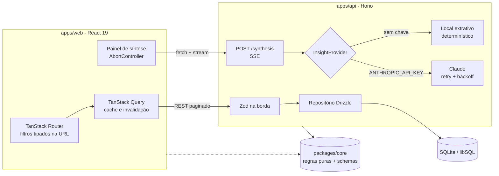

# InsightHub · Research & AI Insights Workspace

[](https://github.com/NasckDev/insighthub/actions/workflows/ci.yml)


Workspace para explorar pesquisas, comparar segmentos e gerar sínteses assistidas por IA **com rastreabilidade**: toda afirmação da síntese aponta para o id da resposta que a sustenta.

> Todos os dados são **100% fictícios** (seed determinístico com produto inventado "Atlas Analytics").

## Problema

Times de pesquisa e produto precisam transformar respostas, segmentos e indicadores em insights acionáveis. A experiência costuma ser fragmentada entre filtros complexos, tabelas, gráficos, comentários e geração de sínteses — e sínteses de IA sem fonte não são confiáveis.

## Status

| Parte | Estado |
| --- | --- |
| `packages/core` — regras de domínio (NPS, filtros, comparação, retry, síntese extrativa, seed) | ✅ pronto, testado |
| `apps/api` — Hono + Zod + Drizzle/libSQL, SSE com cancelamento, rate limit, CORS restrito | ✅ pronto, testado |
| `apps/web` — React 19 + TanStack Router/Query + Tailwind 4 | 🚧 próxima etapa (ver [Roadmap](#roadmap)) |

## Arquitetura



`packages/core` concentra as regras puras e os **schemas Zod compartilhados**: o mesmo schema de filtros valida a query string na API e (na web) os search params da URL — uma única fonte de verdade.

## Rodando localmente

Pré-requisito: Node 22+.

```bash
npm install
cp .env.example .env            # opcional
npm run db:setup -w @insighthub/api   # cria o SQLite e aplica o seed fictício
npm run start -w @insighthub/api      # http://localhost:3333
```

Testes e typecheck:

```bash
npm test          # Vitest em todos os workspaces
npm run typecheck
```

### Variáveis de ambiente

Veja [.env.example](.env.example). Nenhum segredo fica no código: `ANTHROPIC_API_KEY` é lida do ambiente e é **opcional** — sem ela a API usa o provider local determinístico.

| Variável | Padrão | Descrição |
| --- | --- | --- |
| `PORT` | `3333` | Porta da API |
| `DATABASE_URL` | `file:./insighthub.db` | URL libSQL (arquivo local por padrão) |
| `CORS_ORIGINS` | `http://localhost:5173` | Origens permitidas (lista separada por vírgula) |
| `RATE_LIMIT_PER_MINUTE` | `120` | Limite geral por cliente |
| `SYNTHESIS_LIMIT_PER_MINUTE` | `10` | Limite do endpoint de síntese |
| `ANTHROPIC_API_KEY` | — | Ativa o provider Claude |
| `ANTHROPIC_MODEL` | `claude-opus-5-5` | Modelo usado pelo provider Claude |

## API

Todas as respostas JSON usam o envelope `{ success, data, error, meta }`.

| Método | Rota | Descrição |
| --- | --- | --- |
| GET | `/api/health` | Status e provider ativo |
| GET | `/api/surveys` | Pesquisas com total de respostas e NPS |
| GET | `/api/surveys/:id` | Pesquisa com perguntas (NPS, escolha única, múltipla, aberta) |
| GET | `/api/surveys/:id/responses` | Respostas paginadas. Filtros: `plan`, `region`, `role` (listas por vírgula), `nps`, `q`, `page`, `pageSize` (≤ 100) |
| GET | `/api/surveys/:id/responses/:responseId` | Resposta-fonte (destino das citações) |
| GET | `/api/surveys/:id/compare?dimension=plan\|region\|role` | NPS e distribuição por segmento, com flag de amostra pequena |
| POST | `/api/surveys/:id/synthesis` | Síntese em **SSE** (`meta`, `delta`, `citation`, `done`, `error`). Corpo: `{ "filters": {...} }` |

Exemplo:

```bash
curl "http://localhost:3333/api/surveys/s-atlas-q3/compare?dimension=plan&region=sul,sudeste"
curl -N -X POST http://localhost:3333/api/surveys/s-atlas-q3/synthesis \
  -H "content-type: application/json" -d '{"filters":{"plan":["free"]}}'
```

## Decisões

- **Filtros persistidos na URL** para visões compartilháveis — o schema de filtros vive no `core` e é reutilizado na borda da API. ([ADR 0002](docs/adr/0002-filtros-na-url-e-schemas-compartilhados.md))
- **`InsightProvider`** como contrato da síntese: provider local extrativo (frequências por tema + citação representativa com id da resposta) e provider Claude opcional. ([ADR 0001](docs/adr/0001-insight-provider-com-fallback-local.md))
- **Rastreabilidade**: citações `[#id]` geradas pelo modelo são validadas contra o conjunto de fontes enviado; ids inexistentes são descartados e a citação usa o texto real da resposta, nunca o texto do modelo.
- **Cancelamento e retry**: o cancelamento do cliente aborta o stream (AbortController ponta a ponta); o retry com backoff exponencial só reexecuta erros transitórios (429, 5xx, conexão) e respeita o abort.
- **Segurança** (sem autenticação por ser demo; antes de expor o provider Claude publicamente, adicione auth e orçamento de chamadas): validação Zod em toda entrada, ids com regex restrita, busca parametrizada com `instr()` (sem curingas de `LIKE`), CORS por lista de origens, `secureHeaders`, limite de corpo de 16 KB, rate limit por IP, comentários tratados como dados no prompt (mitigação de prompt injection).

## Testes

- `packages/core`: NPS, filtros/validação, comparação de segmentos, retry/backoff/abort, síntese extrativa e citações, seed determinístico.
- `apps/api`: integração com `app.request()` sobre SQLite em memória — envelope, paginação, filtros, 400/404, SSE, CORS e 429.

## Roadmap

- [ ] `apps/web`: lista de pesquisas, explorador com filtros na URL (TanStack Router), comparação com gráfico + tabela alternativa, painel lateral redimensionável por teclado, síntese em streaming com botão cancelar e citações clicáveis.
- [ ] Playwright + `@axe-core/playwright` nos fluxos principais.
- [ ] Deploy do front com dados mock no GitHub Pages (o `core` já roda no browser: seed + provider local).
- [ ] OpenAPI.

## Licença

[MIT](LICENSE) © Alexandre Diogo Nascimento
